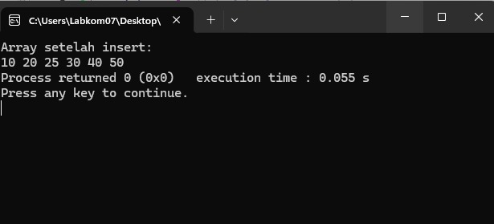
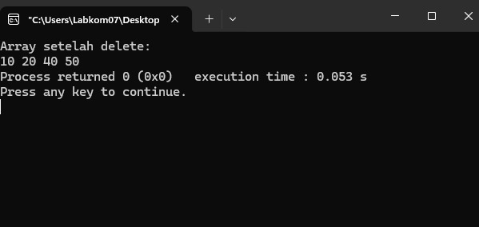
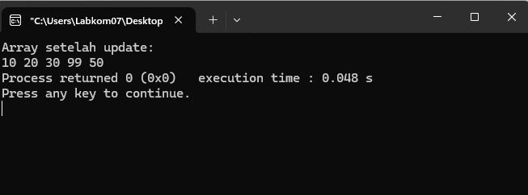

# Operasi-Dasar-insert-delete-update-
Belajar Pemrograman dasar bahasa c Operasi Dasar (insert, delete, update)

- **Nama:** Siti Solihah
- **NIM:** C2583207029
- **Mata Kuliah:** algoritma Pemrogrman Lanjut

## 📸 Hasil Tampilan Coding

### 1. Hasil INSERT

### 2. Hasil DELETE

### 3. Hasil UPDATE

